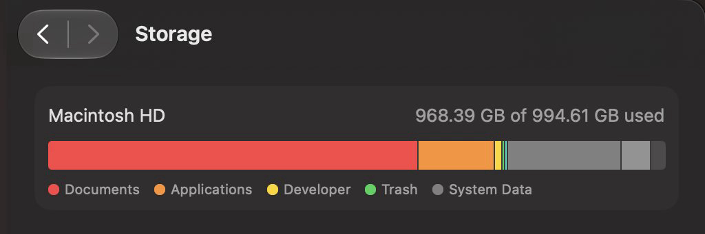
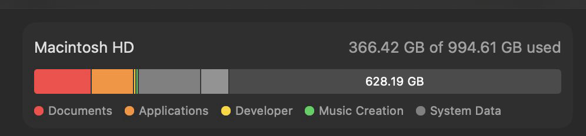

# Storage Rescue

An instruction-only Agent Skill for safely freeing storage on Windows and macOS. It gives an AI agent two ways to work: move your big files to an external drive and verify them before deleting anything, or, with no drive, delete only caches and the things you say you no longer want. The agent asks before every move and every deletion.

Version 1.0.0. MIT license. Maintained by Da7-Tech.

## Before and after

A 1 TB Mac before and after the cleanup this skill was written from, carried out by Claude Opus 5.5 in Factory Droid using both modes:

**Before:** 968.39 GB of 994.61 GB used.



**After:** 366.42 GB used, 628.19 GB free.



## Why this exists

A full computer is rarely full of caches. The space usually sits in large things: old projects, AI models, movies and recordings, installers, backups, chat histories, simulator runtimes. Most cleanup tools only clear caches, and the ones that go further tend to decide on their own what you do not need.

Storage Rescue tells the agent how to go after the large things safely. It surveys first, explains what it found, asks you what to do with each group, and only then acts. An offloaded source stays on the computer until its external copy is verified, and nothing is deleted without your answer.

It is plain text: a `SKILL.md` plus reference files the agent loads when it needs them. There is no runtime, no script to install, and no network call of its own. You hand it to your agent and the agent follows it.

## Two modes

The agent's first question picks the mode: do you have an external drive to move files to?

- **Offload (you have a drive).** Large, rarely used files are copied to the drive and compared by SHA-256 twice, once right after copying and again after the drive is safely disconnected and reconnected. Only then is the source eligible for removal. Every move is recorded in a manifest on the drive, next to a plain-text README that says what went where and how to restore it. Filesystem and metadata checks follow the selected platform: macOS supports APFS, exFAT, FAT32, and NTFS (NTFS through the free, open-source [anylinuxfs](https://github.com/nohajc/anylinuxfs) on Apple Silicon, or a driver you already have); Windows uses native filesystem support, including NTFS, exFAT, and FAT32.
- **Reclaim (no drive).** Nothing is moved; what goes is deleted. That means caches and build output that programs rebuild on their own, cleared with each tool's official command, plus anything you decide you no longer want. Your personal files go through the Trash on macOS or Recycle Bin on Windows first, and emptying it is a separate confirmation. There is no silent fallback to permanent deletion when recycling is unavailable.

Both modes can run in one session: offload your files, then reclaim caches.

## How it works

1. **Questions first.** Detect the operating system, then establish drive or no drive, what must stay on the computer, and which kinds of files are open for discussion.
2. **Read-only survey.** The agent measures where the space went, including "System Data", and changes nothing.
3. **Grouped questions with options.** Findings come back as a few short questions by category, each with sizes and choices such as move to the drive, delete, or keep, using your agent's question tool. The agent marks what it recommends and why.
4. **Action only on your answers.** Anything you did not approve is left alone. If something new turns up along the way, the agent stops and asks again.
5. **Check and report.** Apps whose data changed are reopened to confirm they still start and you are still signed in. Free space before and after is measured, not estimated.

## Safety model

- Silence, a skipped question, or "just delete the junk" is not approval. The agent shows what it found and gets a specific yes.
- In Offload mode, a source is deleted only after every copied file matched twice, the source is unchanged since it was copied (re-hashed right before deletion), and only the entries that were verified are deleted. Anything else stays and is reported.
- Metadata checks follow the platform. The macOS workflow checks extended attributes, Finder tags, and ACLs; Windows checks NTFS ACLs, alternate data streams, EFS, links, and destination filesystem limits. Items stay on the source unless fidelity is established or you explicitly accept the identified metadata loss.
- Official routes first: macOS tools such as `brew cleanup` and `xcrun simctl`, Windows Storage settings, package-manager cleanup commands with their scope checked, and in-app "Clear cache" screens. Executable tool caches can be in use; a cache name alone does not make them disposable.
- Paths referenced by your shell profile, launch agents, scheduled tasks, services, or app configs are kept.
- Photos, Mail, Messages, Keychains, SSH keys, credentials, and system folders are protected: the agent leaves them alone unless you make a specific, informed request. A `.git` folder is never deleted on its own; in Offload mode it only moves inside a verified archive of its whole project.
- No `sudo` or automatic administrator elevation from the agent. When a step needs elevated privileges, you get the exact command to run yourself.

## Windows support

The same installed skill automatically routes Windows requests to [the Windows workflow](skills/storage-rescue/references/windows.md); no separate installation is needed. The existing macOS workflow and references remain available.

Windows guidance covers read-only PowerShell surveys, measured volume free space, Recycle Bin handling, redirected folders and OneDrive placeholders, active agent/MCP caches, Docker/WSL virtual disks, and NTFS-aware offloading with two hash verification passes. WSL and Docker data, system files, and cloud-synced files are not treated as disposable caches. Linux cleanup inside a WSL guest is not a supported third platform; the Windows guidance covers its host-managed storage only.

This is an instruction-only workflow, not a Windows cleanup executable. End-to-end offloading, metadata restoration, and application-specific cleanup still require checks on the actual device.

## Install

The skill is the `skills/storage-rescue/` folder: one `SKILL.md` plus the reference files it links to. Installing means putting a copy of that folder where your agent looks for skills.

With the Skills CLI, from your project:

```
npx skills add Da7-Tech/storage-rescue
```

Add `-g` to install at user level instead of in the current project.

Manual install: copy the whole `skills/storage-rescue/` folder, including `references/`, into the directory your agent reads. Copying only `SKILL.md` is not enough, because it links to the other files.

| Agent | Project directory | User directory |
| --- | --- | --- |
| Claude Code | `.claude/skills/storage-rescue/` | `~/.claude/skills/storage-rescue/` |
| Codex | `.agents/skills/storage-rescue/` | `~/.agents/skills/storage-rescue/` |
| Cursor | `.agents/skills/storage-rescue/` or `.cursor/skills/storage-rescue/` | `~/.cursor/skills/storage-rescue/` or `~/.agents/skills/storage-rescue/` |
| Factory Droid | `.factory/skills/storage-rescue/` | `~/.factory/skills/storage-rescue/` |
| Devin CLI | `.devin/skills/storage-rescue/` | `~/.config/devin/skills/storage-rescue/` |
| Hermes Agent | `.hermes/skills/storage-rescue/` | `~/.hermes/skills/storage-rescue/` |

Agents change their paths from time to time; if the skill is not discovered, check your agent's current documentation.

To read the skill without installing anything, open [SKILL.md](skills/storage-rescue/SKILL.md). It is the same text the agent gets.

## Use

Ask in your own words, in any language:

> My Mac is full. I have an external drive. Use Storage Rescue to move old things there safely.

> No drive. Use Storage Rescue and free as much space as you safely can.

> What is this huge "System Data" on my Mac, and can any of it go?

> My Windows C: drive is full. Use Storage Rescue to inspect it, keep my current projects and VPS setups, and show me cleanup options before deleting anything.

## What is in this repository

```
skills/storage-rescue/
├── SKILL.md                         workflow, rules, and when to ask
└── references/
    ├── offload-protocol.md          verified copy, archives, manifest, reference implementation
    ├── external-drives.md           file systems, NTFS writing, testing, safe eject
    ├── reclaim-catalog.md           what can go, with which command, under which condition
    ├── app-data.md                  chat databases, messenger caches, VMs, models
    ├── system-data.md               what "System Data" is made of on macOS
    └── windows.md                   Windows survey, reclaim, and verified offload workflow
assets/                              the before and after screenshots above
```

## Limits

- Windows and macOS are supported through separate instruction paths; other operating systems do not have a cleanup workflow.
- Offload mode leaves a single copy on the external drive. Keep a second backup of anything irreplaceable.
- Some steps need you: running a command with elevated privileges, approving an OS privacy prompt, safely reconnecting a drive, or pressing a button inside an app.
- Folder-size estimates can overstate what deletion frees (APFS clones, NTFS hard links, sparse or compressed files, cloud placeholders). Reports use measured volume free space before and after; Windows reports do not assume logical file lengths equal allocated disk space.

## Credits

- **The cleanup in the screenshots** was carried out by Claude Opus 5.5 running in [Factory Droid](https://factory.ai).
- **The skill** was written by Claude Opus 5.5 in Factory Droid, working with Da7-Tech.
- **Independent review** of the skill: GPT-6 Astra.

## License

MIT. See [LICENSE](LICENSE).
